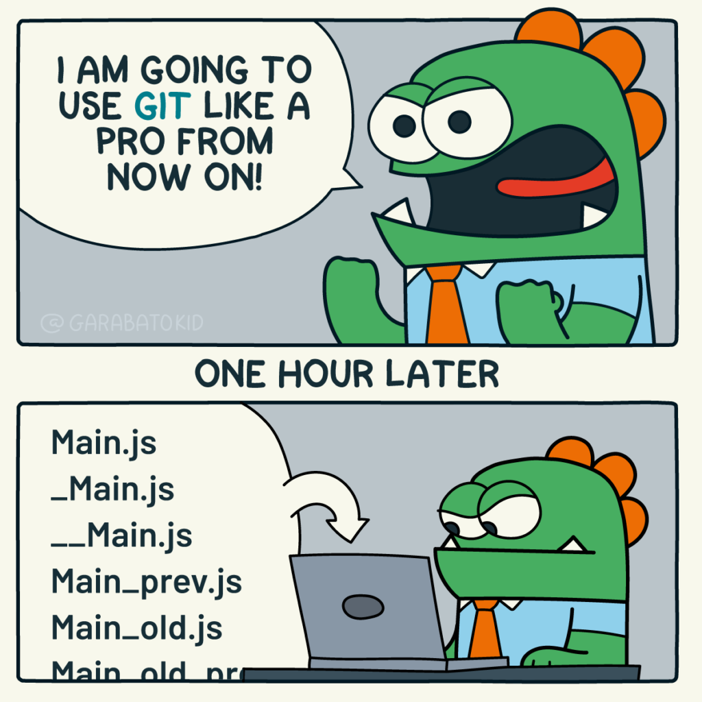
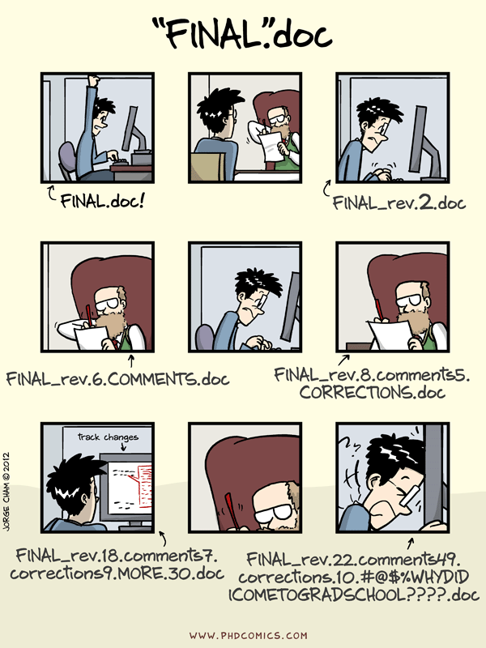
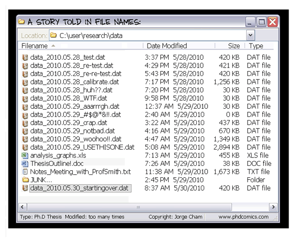
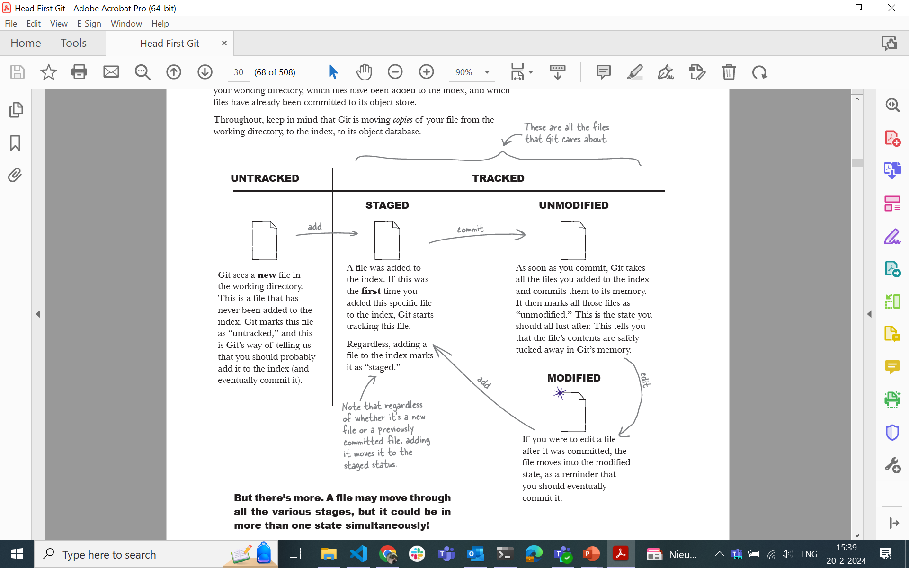
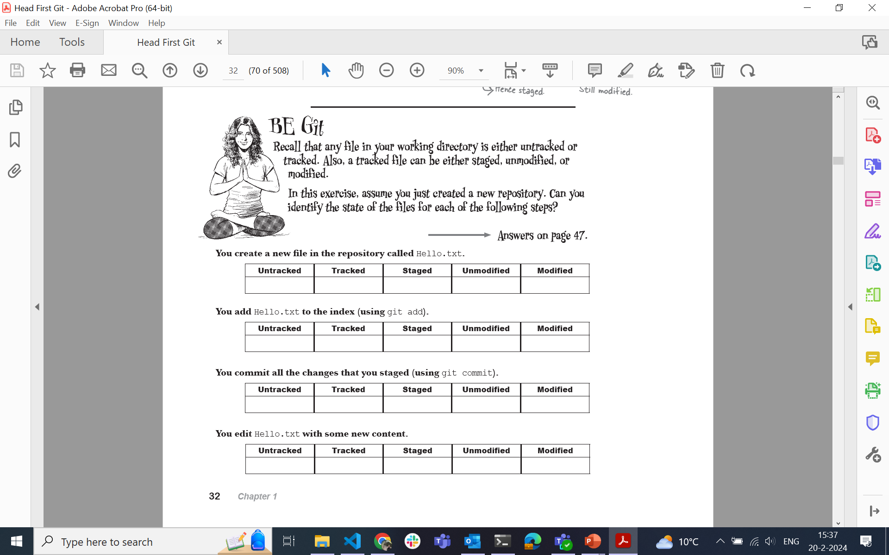
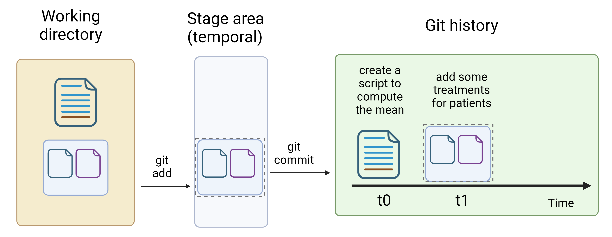
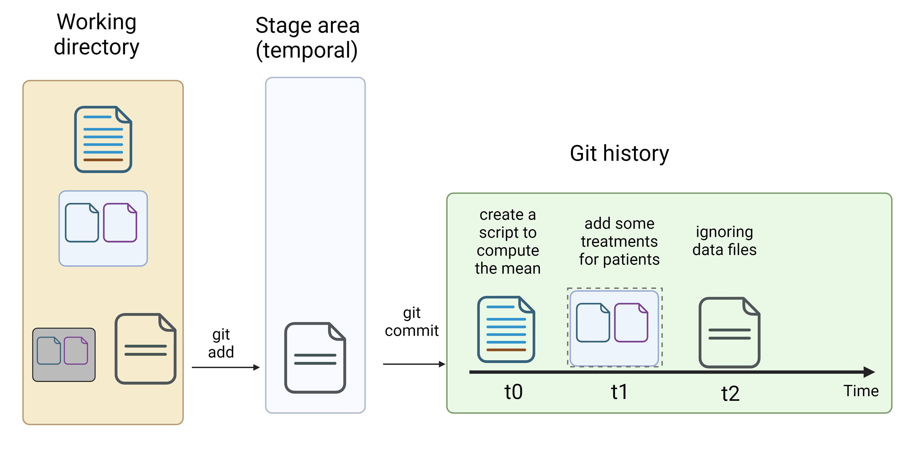
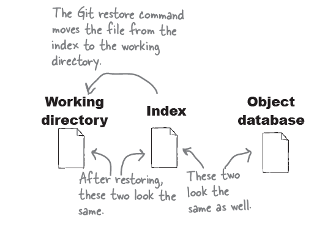
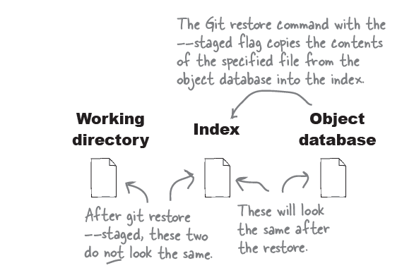

<!-- Converted from Git-intro-lesson.pptx; 1 slide per original PPTX slide.
     Images are stored under ./images/git-intro-lesson/. -->

# Version control with Git

<!-- Source slide 1 -->

{width="83%"}

## Overview

<!-- Source slide 2 -->

- Why Git
- What is Git
- How to use Git

## Why Git, or any other version control software?

::: {.fragment}

**Reviewing a draft document (offline)**

::: {.columns}
::: {.column width="50%"}
{width="64%"}
:::

::: {.column width="50%"}
{width="88%"}

:::
:::

- Difficult to know which copy contains which change
- Repeated copies of the same information consume storage

:::

## Why Git, or any other version control software?

**A group coding project**

In research and software projects, many people may work on the same files: scripts, data notes, reports, documentation.

::: {.columns}
::: {.column width="33%"}

{width="40%"}

:::

::: {.column width="33%"}

{width="40%"}

:::

::: {.column width="33%"}

{width="40%"}

:::
:::

::: {.pill .p-orange}

Each of them have the same copy of the code base of the project, but they are working on different parts of it.

:::

## A group coding project : *Challenges*

 - How to merge all these different copies together and maintain a final copy of the project?
 - What changed between two versions of the same analysis?
 - Which merge did work and which one did not?
 - Who changed what and when? 

::: {.fragment}

{width="80%"}

:::

## What is Git?

:::{.incremental}

- It was created in 2005 by Linux Torvalds , the same creator of Linux OS.
- Git is **free**, **open source**, **distributed**, **fast** and designed to **scale** to very large projects. Those were explicit design goals from the beginning. 
- Git is version-control software: it records the history of a project and makes it possible to compare, share and combine changes.
- Git is the most dominant version-control system used in software development today. 
- Git was originally built to manage Linux development, but today it is used for: software,research code, data analysis,websites,documentation,books and much more. 
- Was Git originally designed to make version control easy for beginners? 
     - No. It was designed to solve the collaboration problems of one of the world's largest software projects (the development of Linux).
:::

## How to use Git?

<!-- Source slide 15 -->

::: {.pill .p-orange}
The workshop of today!
:::

## Tools

<!-- Source slide 16 -->

- Unix terminal (Git Bash for Windows or WSL)
- Git
- Browser
- GitHub account

## By the end of this lesson, we expect to:

<!-- Source slide 18 -->

- Create a local Git repository
- Manage the history of changes to a file
- Understand Git terminology
- Set up a remote project
- Collaborate with other peers

## Let’s start {.spacious-slide}

## The three areas of Git

::::: {.columns }

:::: {.column width="20%"}

### Working directory

Where you **edit files** and experiment freely.

::::

:::: {.column width="10%" }
`git add`

→
::::

:::: {.column width="20%"}

### Staging area

Where you **select changes** for the next snapshot.

::::

:::: {.column width="10%" .git-transition}
`git commit`

→
::::

:::: {.column width="20%"}

### Git history

Where Git **records snapshots** you can revisit and compare.

::::

:::::

## Git is like taking a photograph!

A **commit** is like taking a snapshot of your project.

::::: {.columns }

:::: {.column width="25%"}

### 🧩 Prepare the scene

**Working directory**

Arrange, change, and experiment with the objects.

::::

:::: {.column width="10%" }
`git add`

→
::::

:::: {.column width="25%"}

### 🖼️ Frame the picture

**Staging area**

Choose which elements/objects will appear in the picture.

::::

:::: {.column width="10%" }
`git commit`

→
::::

:::: {.column width="25%"}

### 📸 Take the picture!

**Git history**

Save the snapshot in your photo album.

::::

:::::

## Tracked, staged and untracked files

<!-- Source slide 21 -->

{width="85%"}

<small>Gandhi, R. (2022). *Head First Git*. O’Reilly Media.</small>

## Tracked, staged and untracked files (continued)

<!-- Source slide 22 -->

{width="85%"}

<small>Gandhi, R. (2022). *Head First Git*. O’Reilly Media.</small>

## Working directory, staging area and Git history: status

<!-- Source slide 23 -->

{width="92%"}

## Git workflow across time

<!-- Source slide 24 -->

{width="92%"}

## git restore

<!-- Source slide 25 -->

`git restore` — described in the source presentation as the opposite of `git add`.

{width="75%"}

::: {.notes}
The wording is retained from the original PowerPoint. In Git, git restore by default discards changes in the working tree; it does not universally undo git add.
:::

## git restore --staged

<!-- Source slide 26 -->

`git restore --staged` — described in the source presentation as the opposite of `git commit`.

{width="75%"}

::: {.notes}
The wording is retained from the original PowerPoint. git restore --staged unstages changes; it does not undo a commit.
:::

