<!-- Converted from Git-intro-lesson.pptx; 1 slide per original PPTX slide.
     Images are stored under ./images/git-intro-lesson/. -->

## Version control with Git

<!-- Source slide 1 -->

::: {.columns}
::: {.column width="42%"}
**Version control with Git**

Understanding how changes accumulate, and how to collaborate without creating endless copies of files.
:::

::: {.column width="58%"}
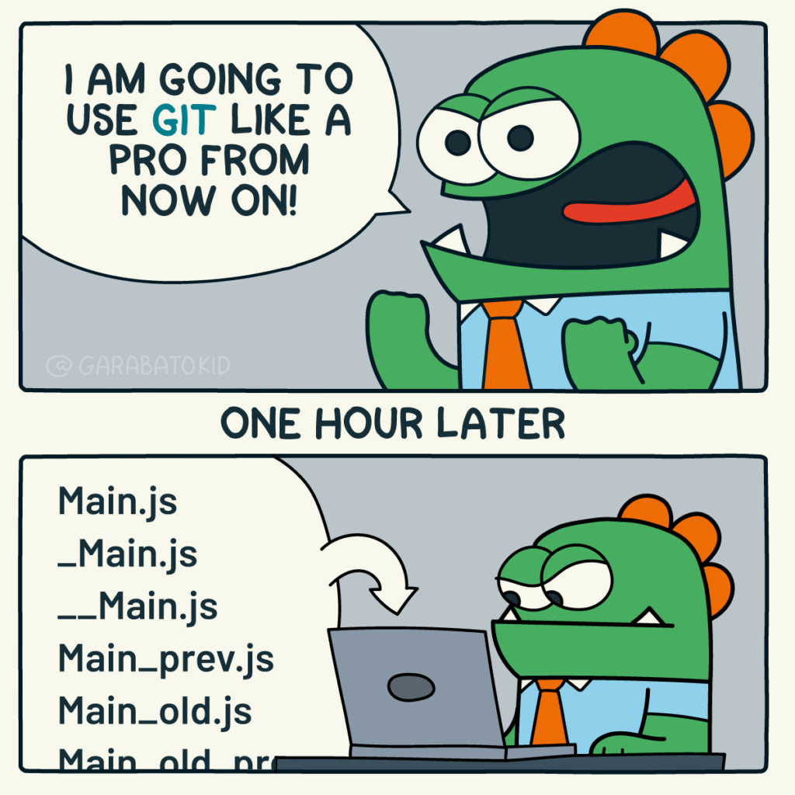{width="83%"}
:::
:::

## Overview

<!-- Source slide 2 -->

- Why Git
- What is Git
- How to use Git

## Why Git?

<!-- Source slide 3 -->

::: {.pill .p-orange}
Or any other version control software
:::

## Situation #1: Reviewing a draft document (offline)

<!-- Source slide 4 -->

::: {.columns}
::: {.column width="47%"}
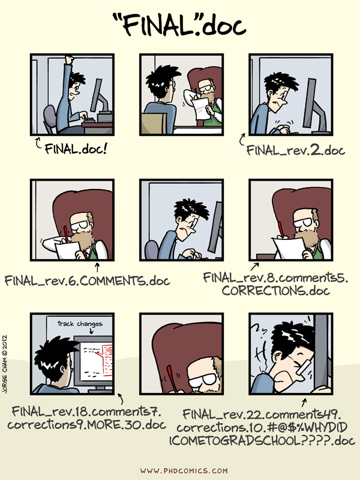{width="64%"}
:::

::: {.column width="53%"}
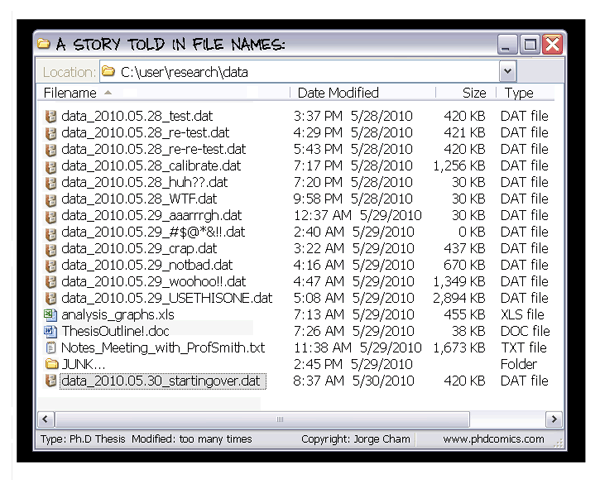{width="88%"}

- Difficult to know which copy contains which change
- Repeated copies of the same information consume storage
:::
:::

## Situation #2: A group coding project

<!-- Source slide 5 -->

::: {.columns}
::: {.column width="33%"}
::: {.pill .p-orange}
Project copy #1
:::

{width="40%"}

**Alice**
:::

::: {.column width="33%"}
::: {.pill .p-grey}
Project copy #2
:::

{width="40%"}

**Laura**
:::

::: {.column width="33%"}
::: {.pill .p-red}
Project copy #3
:::

{width="40%"}

**John**
:::
:::

::: {.notes}
Here talk about the challenges when working a group project of code for example without using version control
:::

## Situation #2: A group coding project

<!-- Source slide 6 -->

::: {.columns}
::: {.column width="33%"}
::: {.pill .p-orange}
Project copy #1
:::

{width="40%"}

**Alice**
:::

::: {.column width="33%"}
::: {.pill .p-grey}
Project copy #2
:::

{width="40%"}

**Laura**
:::

::: {.column width="33%"}
::: {.pill .p-red}
Project copy #3
:::

{width="40%"}

**John**
:::
:::

::: {.note-box}
**Challenge:** How to merge all these different copies together and maintain a final copy of the project?
:::

::: {.notes}
Here talk about the challenges when working a group project of code for example without using version control
:::

## Situation #2: A group coding project

<!-- Source slide 7 -->

::: {.columns}
::: {.column width="33%"}
::: {.pill .p-orange}
Project copy #1
:::

{width="40%"}

**Alice**
:::

::: {.column width="33%"}
::: {.pill .p-grey}
Project copy #2
:::

{width="40%"}

**Laura**
:::

::: {.column width="33%"}
::: {.pill .p-red}
Project copy #3
:::

{width="40%"}

**John**
:::
:::

::: {.note-box}
**Challenge:** How to merge all these different copies together and maintain a final copy of the project?
:::

::: {.pill .p-orange}
John makes his changes and sends his project to Laura
:::

::: {.notes}
Here talk about the challenges when working a group project of code for example without using version control
:::

## Situation #2: A group coding project

<!-- Source slide 8 -->

::: {.columns}
::: {.column width="33%"}
::: {.pill .p-orange}
Project copy #1
:::

{width="40%"}

**Alice**
:::

::: {.column width="33%"}
::: {.pill .p-grey}
Project copy #2
:::

{width="40%"}

**Laura**
:::

::: {.column width="33%"}
::: {.pill .p-red}
Project copy #3
:::

{width="40%"}

**John**
:::
:::

::: {.note-box}
**Challenge:** How to merge all these different copies together and maintain a final copy of the project?
:::

::: {.pill .p-orange}
John makes his changes and sends his project to Laura
:::

::: {.pill .p-orange}
Laura merges her changes and sends it to Alice
:::

::: {.notes}
Here talk about the challenges when working a group project of code for example without using version control
:::

## Situation #2: A group coding project

<!-- Source slide 9 -->

::: {.columns}
::: {.column width="33%"}
::: {.pill .p-orange}
Project copy #1
:::

{width="40%"}

**Alice**
:::

::: {.column width="33%"}
::: {.pill .p-grey}
Project copy #2
:::

{width="40%"}

**Laura**
:::

::: {.column width="33%"}
::: {.pill .p-red}
Project copy #3
:::

{width="40%"}

**John**
:::
:::

::: {.note-box}
**Challenge:** How to merge all these different copies together and maintain a final copy of the project?
:::

::: {.pill .p-orange}
John makes his changes and sends his project to Laura
:::

::: {.pill .p-orange}
Laura merges her changes and sends it to Alice
:::

::: {.pill .p-orange}
Alice merges her changes, reviews, and maintains the final copy
:::

::: {.notes}
Here talk about the challenges when working a group project of code for example without using version control
:::

## Situation #2: Consequences of this solution

<!-- Source slide 10 -->

- Manual approach
- Time consuming
- Error prone
- Not scalable
- Inefficient

## Situation #2: Consequences of this solution

<!-- Source slide 11 -->

- Manual approach
- Time consuming
- Error prone
- Not scalable
- Inefficient

::: {.box}
We need an efficient system that tracks different versions of a project, allowing the team to know who made changes, when, and why.
:::

## What is Git?

<!-- Source slide 12 -->

### Mentimeter

[https://www.menti.com/alx2mugaqr1n](https://www.menti.com/alx2mugaqr1n)

## What is Git? — Menti Poll

<!-- Source slide 13 (hidden in original PowerPoint) -->

::: {.columns}
::: {.column width="50%"}
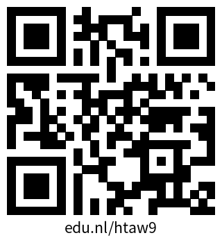{width="75%"}
:::

::: {.column width="50%"}
What do you already know about Git?
:::
:::

::: {.notes}
Originally hidden in PowerPoint.
:::

## What is Git?

<!-- Source slide 14 (hidden in original PowerPoint) -->

{width="40%"}

- Git is the most used version control system. More than 90% of software projects around the world use Git.
- It was created in 2005 by Linus Torvalds, the same creator of Linux.
- It is free, open source, fast, and scalable.

<small>These claims are carried over from the original slides and have not been independently fact-checked.</small>

::: {.notes}
Originally hidden in PowerPoint.
:::

## How to use Git?

<!-- Source slide 15 -->

::: {.pill .p-orange}
The workshop of today!
:::

## Tools

<!-- Source slide 16 -->

- Unix terminal (Git Bash for Windows or WSL)
- Git
- Browser
- GitHub account

## Schedule

<!-- Source slide 17 (hidden in original PowerPoint) -->

| Time | Session |
|:--|:--|
| 09:30–09:45 | Git intro |
| 09:45–11:30 | Setting up a local Git repository |
| 14:30–14:45 | Break |
| 14:45–15:45 | Git cycle and ignoring things |
| 15:30–15:45 | Exercise |
| 15:45–16:00 | Break |
| 16:00–17:00 | Exploring history and concluding remarks |

::: {.notes}
Originally hidden in PowerPoint. Schedule overlaps are retained from the source and should be reviewed before reuse.
:::

## By the end of this lesson, we expect to:

<!-- Source slide 18 -->

::: {.columns}
::: {.column width="64%"}
- Create a local Git repository
- Manage the history of changes to a file
- Understand Git terminology
- Set up a remote project
- Collaborate with other peers
:::

::: {.column width="36%"}
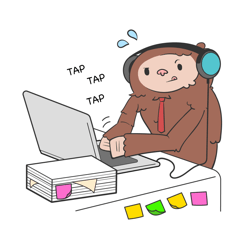{width="80%"}
:::
:::

## Let’s start the lesson

<!-- Source slide 19 -->

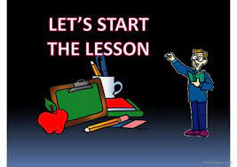{width="65%"}

## The working directory, staging area and Git history

<!-- Source slide 20 -->

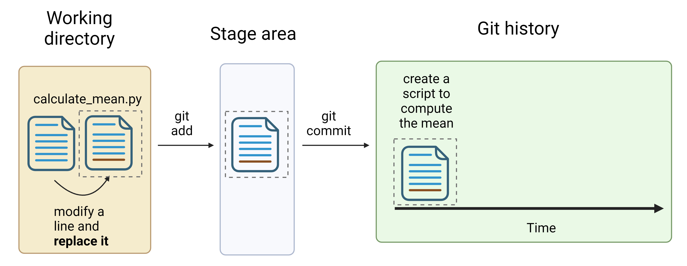{width="93%"}

## Tracked, staged and untracked files

<!-- Source slide 21 -->

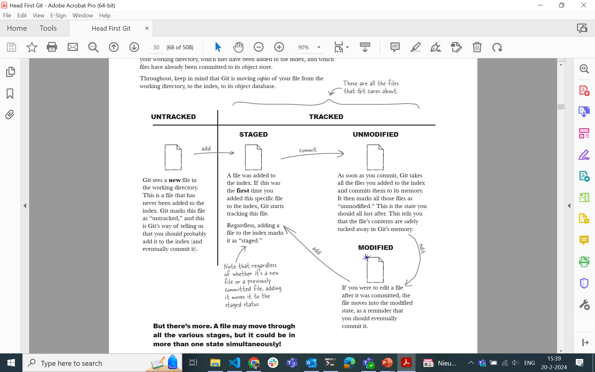{width="85%"}

<small>Gandhi, R. (2022). *Head First Git*. O’Reilly Media.</small>

## Tracked, staged and untracked files (continued)

<!-- Source slide 22 -->

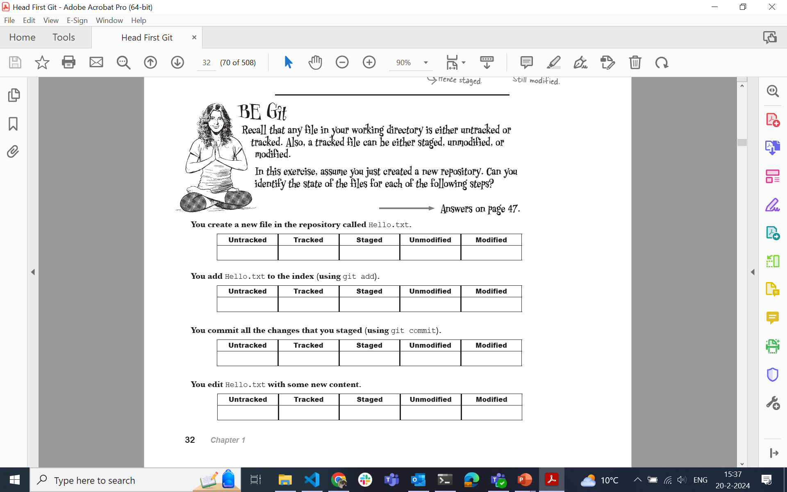{width="85%"}

<small>Gandhi, R. (2022). *Head First Git*. O’Reilly Media.</small>

## Working directory, staging area and Git history: status

<!-- Source slide 23 -->

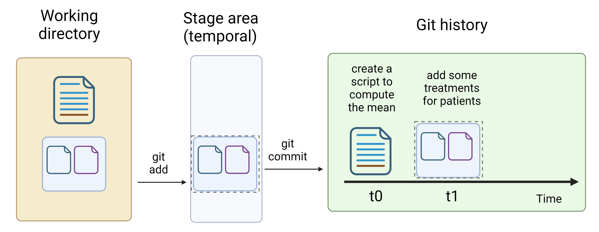{width="92%"}

## Git workflow across time

<!-- Source slide 24 -->

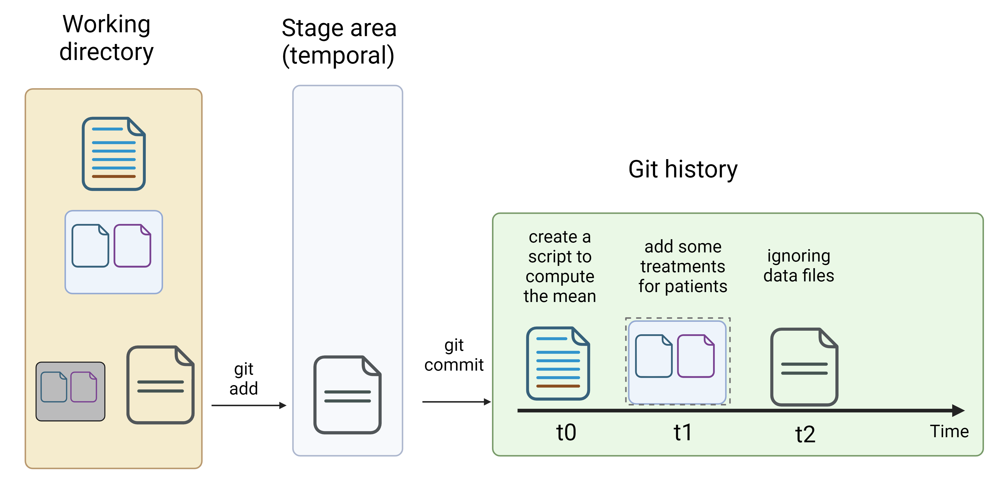{width="92%"}

## git restore

<!-- Source slide 25 -->

`git restore` — described in the source presentation as the opposite of `git add`.

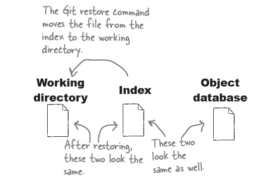{width="75%"}

::: {.notes}
The wording is retained from the original PowerPoint. In Git, git restore by default discards changes in the working tree; it does not universally undo git add.
:::

## git restore --staged

<!-- Source slide 26 -->

`git restore --staged` — described in the source presentation as the opposite of `git commit`.

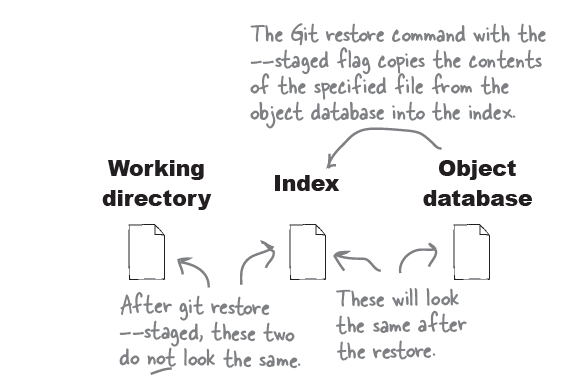{width="75%"}

::: {.notes}
The wording is retained from the original PowerPoint. git restore --staged unstages changes; it does not undo a commit.
:::

