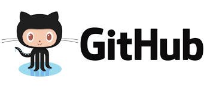
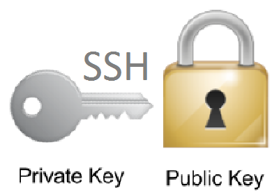
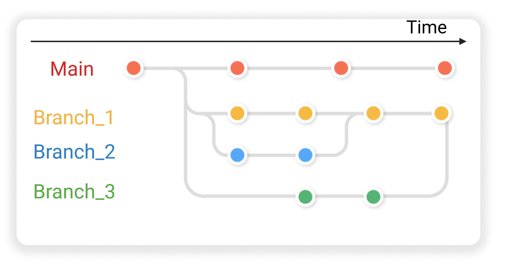
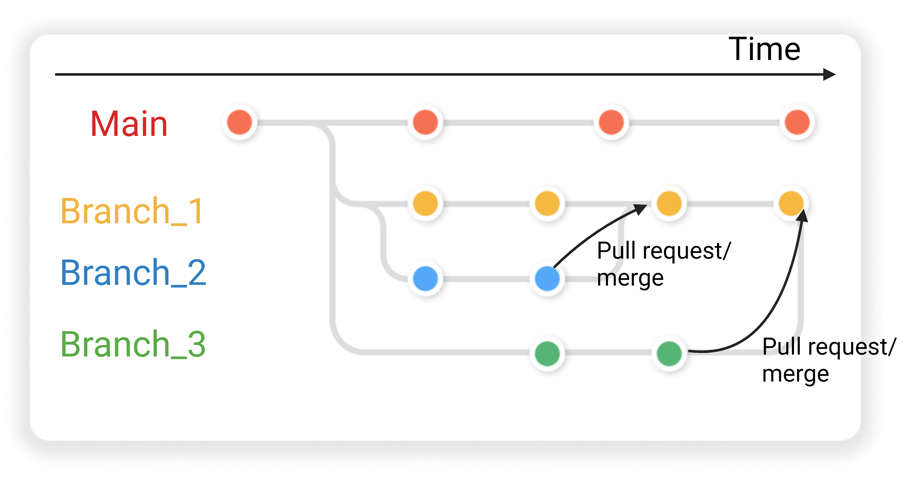

<!-- Converted from Git-remotes-intro-lesson.pptx; 1 slide per original PPTX slide.
     Images are stored under ./images/git-remotes-intro-lesson/. -->

## Git Remotes: GitHub

<!-- Source slide 1 -->

::: {.pill .p-orange}
Git remotes and collaboration
:::


## Git remotes

<!-- Source slide 2 -->

Remote repositories are versions of your project that are hosted on the Internet or somewhere on a network.

Collaborating with others involves managing these remote repositories and **pushing** and **pulling** data to and from them when you need to share work.

**Examples:** GitHub, GitLab, Bitbucket.


## GitHub

<!-- Source slide 3 -->

::: {.columns}
::: {.column width="43%"}
{width="86%"}
:::

::: {.column width="57%"}
- AI-powered developer platform for creating, storing, managing and sharing code
- Combines Git-based distributed version control with access control, issue tracking, feature requests, project management, continuous integration and wikis
- One of the largest source code hosts
:::
:::


## Local and remote repositories

<!-- Source slide 4 -->

::: {.box}
**Remote repository**
:::

::: {.columns}
::: {.column width="33%"}
{width="65%"}

::: {.pill .p-cream}
Fetch / Pull ←
::: ::: {.pill .p-orange}
Push →
:::
:::

::: {.column width="33%"}
{width="65%"}

::: {.pill .p-cream}
Fetch / Pull ←
::: ::: {.pill .p-orange}
Push →
:::
:::

::: {.column width="33%"}
{width="65%"}

::: {.pill .p-cream}
Fetch / Pull ←
::: ::: {.pill .p-orange}
Push →
:::
:::
:::

<small>Push sends local commits to the remote; fetch/pull retrieves changes from a remote.</small>


## Schedule

<!-- Source slide 5 -->

**13:30–15:30**

Types of collaborations and good practices for collaboration

**15:30–16:30**

Get to know 4TU.ResearchData, described in the original presentation as a trusted repository for research data and software in natural and engineering sciences and design.


## Let’s start the lesson

<!-- Source slide 6 -->

{width="62%"}


## SSH connection

<!-- Source slide 7 -->

::: {.columns}
::: {.column width="48%"}
{width="85%"}
:::

::: {.column width="52%"}
**Secure Shell (SSH)** is a cryptographic network protocol for operating network services securely over an unsecured network, by providing a secure channel between an SSH client and an SSH server.

::: {.note-box}
SSH keys can be used to authenticate a user when interacting with a Git remote.
:::
:::
:::


## Dealing with conflicts when collaborating in a project

<!-- Source slide 8 (hidden in original PowerPoint) -->

::: {.columns}
::: {.column width="50%"}
{width="30%"}

**Alice**

```bash
git add .
git commit -m "message"
git pull
git push
```
:::

::: {.column width="50%"}
{width="30%"}

**John**

```bash
git add .
git commit -m "message"
git push
```
:::
:::

::: {.note-box}
Both collaborators coordinate changes through a shared remote repository.
:::

::: {.notes}
Originally hidden in PowerPoint.
:::


## Branches over time

<!-- Source slide 9 -->

{width="89%"}


## Pull requests and merging

<!-- Source slide 10 -->

{width="89%"}

