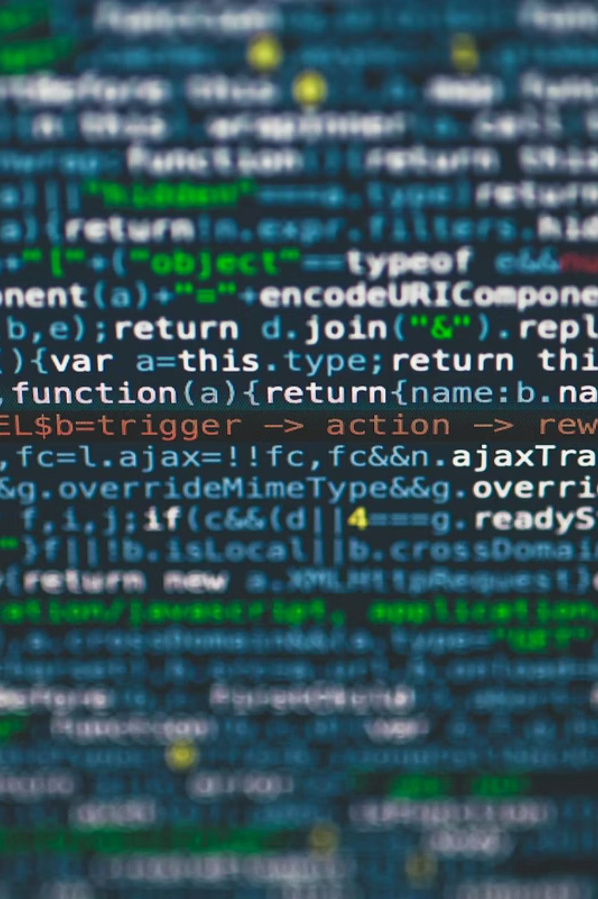

<!-- Converted from Unix-Shell-Introduction.pptx; 1 slide per original PPTX slide.
     Images are stored under ./images/unix-shell-introduction/. -->

## Unix Shell introduction

<!-- Source slide 1 -->

::: {.columns}
::: {.column width="53%"}
**The Unix Shell**

A command-line interface for working with files and automating repeated tasks.
:::

::: {.column width="47%"}
{width="90%"}
:::
:::

## How humans interact with computers

<!-- Source slide 2 -->

::: {.columns}
::: {.column width="33%"}
{width="42%"}

**Keyboard**

<small>The original text-based input method, which is direct and precise.</small>
:::

::: {.column width="33%"}
{width="42%"}

**Touch Screens**

<small>Intuitive gestures for mobile and tablet environments.</small>
:::

::: {.column width="33%"}
{width="42%"}

**Voice Recognition**

<small>Natural language input, growing but still limited in precision.</small>
:::
:::

::: {.columns}
::: {.column width="50%"}
{width="42%"}

**Mouse & GUI**

<small>Graphical interfaces made computing accessible to everyone.</small>
:::

::: {.column width="50%"}
{width="42%"}

**CLI**

<small>Command-Line Interface: powerful, scriptable, and built for repetition.</small>
:::
:::

::: {.notes}
Over the decades, we've developed many ways to communicate with machines. Each has its strengths , but they're not all equal when it comes to efficiency.
:::

## GUIs scale poorly with repetitive tasks

<!-- Source slide 3 -->

::: {.columns}
::: {.column width="53%"}
{width="100%"}
:::

::: {.column width="47%"}
**The problem**

Imagine you need to create 50 directories, rename hundreds of files, or run the same operation across many datasets. In a GUI, that means copy-paste, click-click-click — wasting time and energy.

::: {.note-box}
The more repetitive the task, the greater the advantage of the CLI. A single command can replace hundreds of manual clicks.
:::
:::
:::

## Key points about the Unix Shell

<!-- Source slide 4 -->

::: {.columns}
::: {.column width="66%"}
::: {.cream-box}
**Decades of proven use**

The Unix shell has been around for over 50 years, older than most of its users today. It has survived because it works.
:::

::: {.cream-box}
**Unmatched Productivity**

Its longevity is no accident. The Unix shell is one of the most productive programming environments ever created, enabling complex workflows with minimal effort.
:::

::: {.cream-box}
**Worth the Learning Curve**

Graphical interfaces feel easier at first, but once you learn the terminal, you'll wonder how you ever worked without it.
:::
:::

::: {.column width="34%"}
{width="76%"}
:::
:::

## Unix, Shell, Terminal, Bash — What’s the Difference?

<!-- Source slide 5 -->

These terms are often used interchangeably, but they refer to distinct layers of the system.

::: {.columns}
::: {.column width="51%"}
{width="96%"}
:::

::: {.column width="49%"}
**Breaking it down**

**Unix** — The operating system itself: the foundation everything runs on.

**Shell** — The “language” used to send commands to the OS.

**Terminal** — The application window where you interact with the shell.

**Bash** — A specific, widely used implementation of a Unix shell.
:::
:::

## What you’ll use today

<!-- Source slide 6 -->

The exact tool depends on your operating system — but the commands you learn will work everywhere.

::: {.columns}
::: {.column width="50%"}
::: {.cream-box}
### 🪟 Windows

**Git Bash** — a lightweight Bash emulation that comes bundled with Git for Windows. It gives you a Unix-like environment on a Windows machine.
:::
:::

::: {.column width="50%"}
::: {.cream-box}
### 🍎 macOS / 🐧 Linux

**Unix Shell** — the classic, native command-line environment. macOS and Linux ship with Bash (or Zsh) built right in. No extra installation needed.
:::
:::
:::

## You

<!-- Source slide 7 -->

::: {.columns}
::: {.column width="61%"}
This workshop is designed for **beginners**. No prior command-line experience is expected. We'll start from the very basics and build up together.

::: {.cream-box}
**No experience needed**

We start from zero.
:::

::: {.cream-box}
**Hands-on practice**

You'll type real commands as we go.
:::

::: {.cream-box}
**Ask questions**

There are no bad questions here.
:::
:::

::: {.column width="39%"}
{width="87%"}
:::
:::

## You

<!-- Source slide 8 -->

::: {.columns}
::: {.column width="62%"}
How often do you currently use the command line?

{width="96%"}
:::

::: {.column width="38%"}
{width="85%"}
:::
:::

## Your expectations for this Workshop

<!-- Source slide 9 -->

::: {.columns}
::: {.column width="68%"}
**1.** “I want to learn how to manage my code with Git and how to collaborate with others on Git.”

**2.** “I want to learn everything about Unix shell and Git because they are new to me. What’s more important is that managing my data and codes in a good way can really help me to conduct all my research tasks.”

**3.** “Smoothly collaborating using Github.”
:::

::: {.column width="32%"}
{width="85%"}
:::
:::

## Meet Nelle Nemo, Our case study

<!-- Source slide 10 -->

::: {.columns}
::: {.column width="35%"}
{width="77%"}
:::

::: {.column width="65%"}
**Who is Nelle?**

Nelle Nemo is a marine biologist who has collected thousands of biological samples. She needs to process **1,520 files**, and doing it by hand would take weeks.

**By the end of this lesson, you'll have the skills to help her:**

- Navigate directories and files
- Create and organize data
- Chain commands together
- Automate tasks with loops and scripts
- Search efficiently through files
:::
:::

## Download the Workshop Data

<!-- Source slide 11 -->

Before we begin, download the sample data files we'll use throughout the lesson. These contain the sample files Nelle needs to process.

::: {.columns}
::: {.column width="50%"}
::: {.box}
**📦 Download Link**

Copy the link below in your browser to download the ZIP file containing all workshop data.

**[https://edu.nl/xhydh](https://edu.nl/xhydh)**
:::
:::

::: {.column width="50%"}
::: {.cream-box}
**What's Inside**

- Sample data files for Nelle’s research
- Practice directories and nested folders
- Example text files for searching and processing

Unzip the file to your Desktop or Home folder before the workshop starts.
:::
:::
:::

