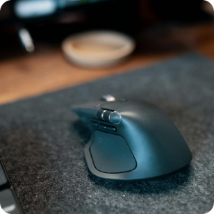
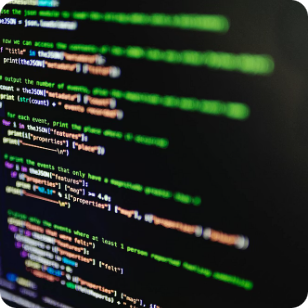
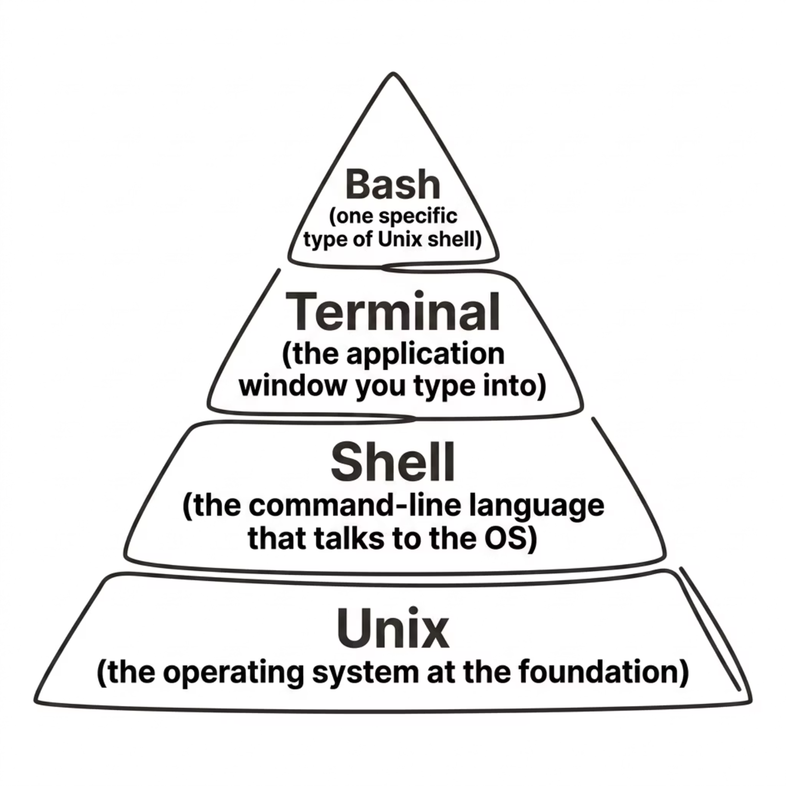
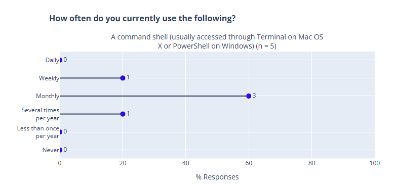

<!-- Converted from Unix-Shell-Introduction.pptx; 1 slide per original PPTX slide.
     Images are stored under ./images/unix-shell-introduction/. -->

## How humans interact with computers

::: {.columns}
::: {.column width="33%"}
::: {.fragment}

{width="42%"}

<small>The original text-based input method, which is direct and precise.</small>

:::
:::

::: {.column width="33%"}
::: {.fragment}

{width="42%"}

<small>Intuitive gestures for mobile and tablet environments.</small>

:::
:::

::: {.column width="33%"}
::: {.fragment}

{width="42%"}

<small>Natural language input, growing but still limited in precision.</small>

:::
:::
:::

::: {.columns}
::: {.column width="50%"}
::: {.fragment}

{width="42%"}

<small>Graphical interfaces made computing accessible to everyone.</small>

:::
:::

::: {.column width="50%"}
::: {.fragment}

{width="42%"}

<small>Command-Line Interface: powerful, scriptable, and built for repetition.</small>

:::
:::
:::

## GUIs scale poorly with repetitive tasks

<!-- Source slide 3 -->

::: {.columns}
::: {.column width="53%"}
{width="100%"}
:::

::: {.column width="47%"}
**The problem**

Imagine you need to create 50 directories, rename hundreds of files, or run the same operation across many datasets. In a GUI, that means copy-paste, and hundreds of clicks. 

:::
:::

## Key points about the Unix Shell

::: {.incremental}

- **Unix was partly born out of a video game! (1969)**  
  Ken Thompson's work on a space exploration game called *Space Travel* helped set the stage for developing Unix at Bell Labs. 🚀

- **The name Unix started as a joke!**  
  Unix was inspired by an older operating system called *Multics*. The name *Unics* was a playful reference to its simpler design. It eventually became *Unix*.

- **Unix commands have strange names for a reason!**  
  `grep` comes from an old text-editor instruction (`g/re/p`), while `cat` stands for *concatenate*, not the animal! 🐈

- **One tiny symbol made Unix incredibly powerful: `|`**  
  The pipe connects small programs, allowing the output of one command to become the input of another. Think of it as an assembly line for data!

- **Technology from 1969 is still everywhere!**  
  Unix-style commands are still used on Linux, macOS, research servers, and supercomputers. Learning the shell means learning a language that has survived generations of technology.

:::

## Unix, Shell, Terminal, Bash — What’s the Difference?

<!-- Source slide 5 -->

These terms are often used interchangeably, but they refer to distinct layers of the system.

::: {.columns}
::: {.column width="51%"}
{width="96%"}
:::

::: {.column width="49%"}
**Breaking it down**

**Unix** — The operating system itself: the foundation everything runs on.

**Shell** — The “language” used to send commands to the OS.

**Terminal** — The application window where you interact with the shell.

**Bash** — A specific, widely used implementation of a Unix shell.
:::
:::

## What you’ll use today {.spacious-slide}

::: {.fragment}

- **Git Bash (for windows users)** 🪟 

A lightweight Bash emulation that comes bundled with Git for Windows. It gives you a Unix-like environment on a Windows machine.

:::

::: {.fragment}

- **Unix shell (for the rest)** 🍎 /🐧 

The classic, native command-line environment. macOS and Linux ship with Bash (or Zsh) built right in. No extra installation needed.

:::

## Target audience

<!-- Source slide 7 -->

This workshop is designed for **beginners**. No prior command-line experience is expected. We'll start from the very basics and build up together.

::: {.fragment}
::: {.cream-box}
**Hands-on practice**

Live coding experience.
:::
:::

::: {.fragment}

**Ask questions!!!**

:::

## You

<!-- Source slide 8 -->

::: {.columns}
::: {.column width="62%"}
How often do you currently use the command line?

{width="96%"}
:::

::: {.column width="38%"}
{width="85%"}
:::
:::

## Your expectations for this Workshop

<!-- Source slide 9 -->

::: {.columns}
::: {.column width="68%"}
**1.** “I want to learn how to manage my code with Git and how to collaborate with others on Git.”

**2.** “I want to learn everything about Unix shell and Git because they are new to me. What’s more important is that managing my data and codes in a good way can really help me to conduct all my research tasks.”

**3.** “Smoothly collaborating using Github.”
:::

::: {.column width="32%"}
{width="85%"}
:::
:::

## Meet Nelle Nemo, Our case study

<!-- Source slide 10 -->

::: {.columns}
::: {.column width="35%"}
{width="77%"}
:::

::: {.column width="65%"}
**Who is Nelle?**

Nelle Nemo is a marine biologist who has collected thousands of biological samples. She needs to process **1,520 files**, and doing it by hand would take weeks.

**By the end of this lesson, you'll have the skills to help her:**

- Navigate directories and files
- Create and organize data
- Chain commands together
- Automate tasks with loops and scripts
- Search efficiently through files
:::
:::

## Download the Workshop Data

<!-- Source slide 11 -->

Before we begin, download the sample data files we'll use throughout the lesson. These contain the sample files Nelle needs to process.

::: {.columns}
::: {.column width="50%"}
::: {.box}
**📦 Download Link**

Copy the link below in your browser to download the ZIP file containing all workshop data.

**[https://edu.nl/xhydh](https://edu.nl/xhydh)**
:::
:::

::: {.column width="50%"}
::: {.cream-box}
**What's Inside**

- Sample data files for Nelle’s research
- Practice directories and nested folders
- Example text files for searching and processing

Unzip the file to your Desktop or Home folder before the workshop starts.
:::
:::
:::

