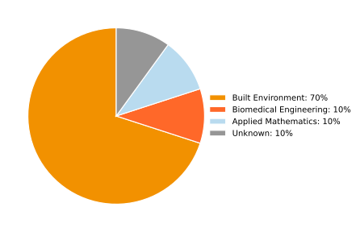
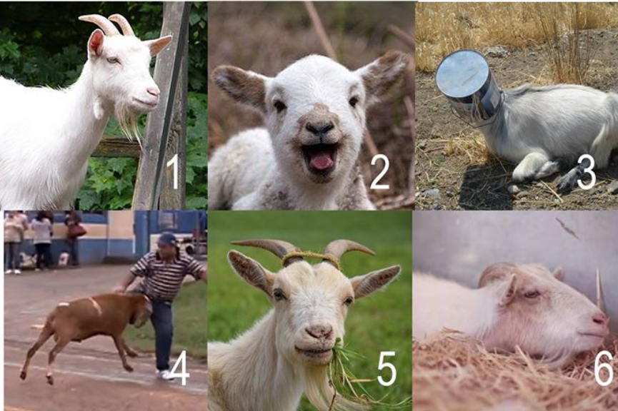

## Program of today (Day 1)

<!-- Source slide 3 -->

| Time | Activity |
|:--|:--|
| 09:30–12:00 | Introduction to the Unix shell |
| 12:00–13:00 | **Lunch** |
| 13:00–16:30 | Version control with Git |
| 14:15–14:30 | **Break** |
| 16:30 | End of workshop — Day 1 |

## The team of the workshop : Instructors

::: {.columns}
::: {.column width="45%"}
{width="55%"}

<small>Skills trainer at 4TU.ResearchData</small>
:::

::: {.column width="45%"}
{width="55%"}

<small>Skills trainer at Tilburg University</small>
:::

:::

## The team of the workshop : Helpers

::: {.columns}
::: {.column width="30%"}
{width="55%"}

<small> Research Data Steward at TU/e </small>
:::

::: {.column width="30%"}
{width="55%"}

<small>Research Data Manager at Utrecht University Library</small>
:::

:::

## The team of the workshop

<!-- Source slide 5 -->

### You!

**Faculty**

{width=75%}

::: {.notes}
Original PowerPoint chart values: Built Environment: 0.6364, Biomedical Engineering: 0.0909, Applied Mathematics: 0.0909, Unknown: 0.0909. The displayed SVG normalizes them to 100%.
:::

## Code of Conduct

<!-- Source slide 6 -->

::: {.columns}
::: {.column width="36%"}
{width="90%"}

<small>The Carpentries teaches foundational coding and data science skills to researchers worldwide.</small>
:::

::: {.column width="64%"}
- Use welcoming and inclusive language
- Be respectful of different viewpoints and experiences
- Gracefully accept constructive criticism
- Show courtesy and respect towards others during the workshop
:::
:::

## Ice breaker

<!-- Source slide 7 -->

Go to **[https://edu.nl/8efu9](https://edu.nl/8efu9)**

**On the goat-scale, how are you feeling today?**

{width="58%"}

